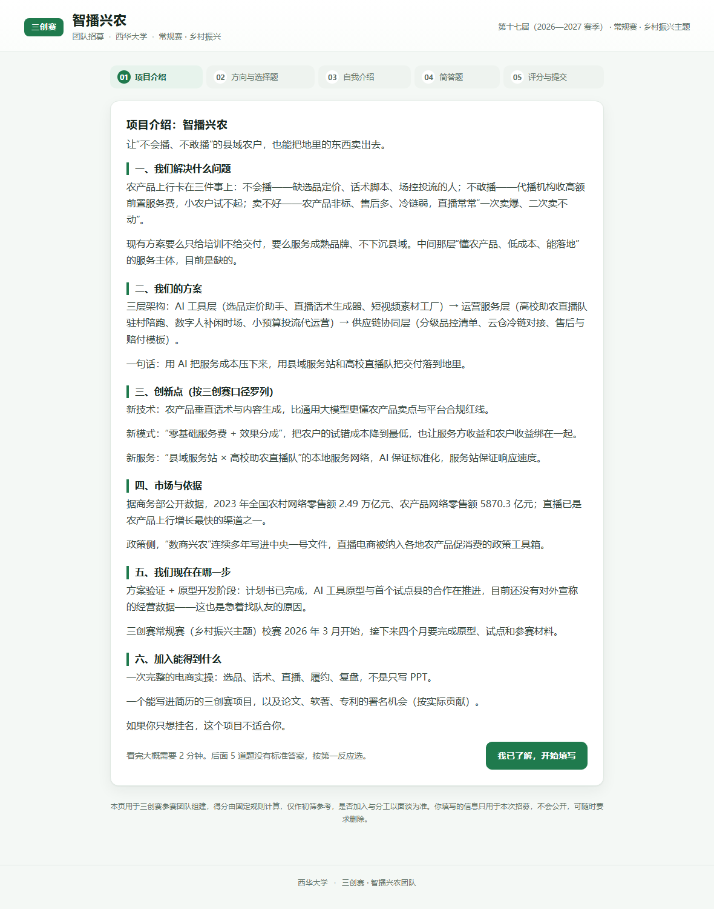
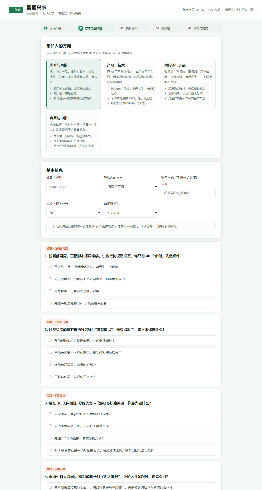
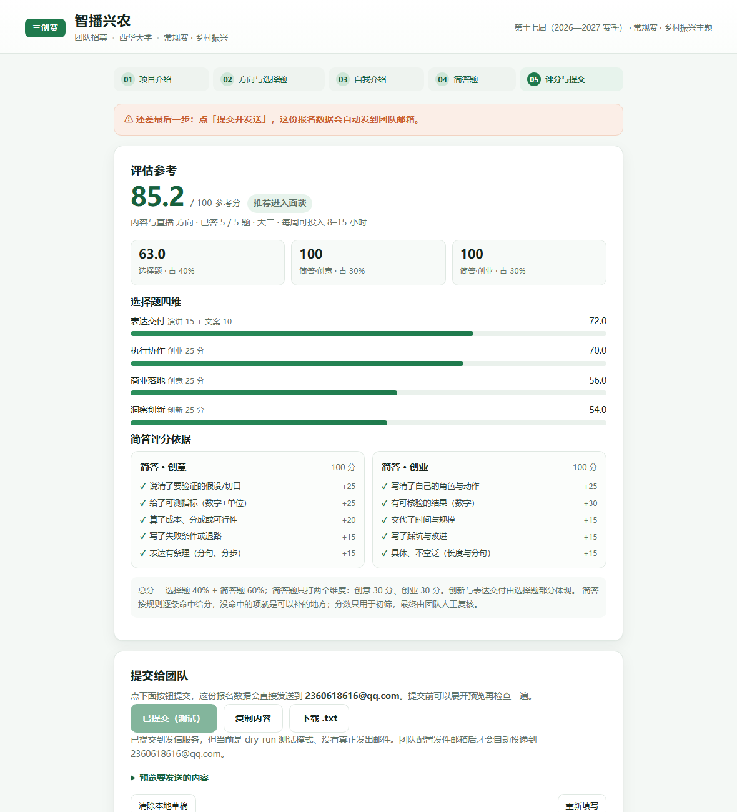

# 智播兴农 · 三创赛组队招募页

一个纯静态的单页报名应用：5 步填写 → 本地规则评分 → 生成报名内容发给团队。无框架、无后端、无第三方依赖，可直接放 GitHub Pages / 任意静态托管。

> 这是一个独立的单页应用：页面结构、样式、评分与交互均为重写，不含任何第三方联系方式、密钥或私有数据。参考过公开的招募页交互形式，但没有改动、复制或部署对方的任何文件。

## 预览

项目介绍页：



方向与选择题：



评估与提交：



## 目录

```
.
├── index.html              # 5 步页面骨架
├── assets/
│   ├── styles.css          # 全部样式（移动端优先）
│   ├── config.js           # 运行配置（邮箱、可选后端地址、草稿策略）——不含任何密钥
│   ├── scoring.js          # 评分内核（纯函数，可被 Node 直接测试）
│   └── app.js              # 交互逻辑
├── data/
│   └── questions.json      # 项目介绍、四个方向、题目与分值、文案
├── tests/
│   └── scoring.test.js     # 评分回归测试
└── README.md
```

## 本地运行

JSON 与模块需要通过 HTTP 加载，直接双击 `index.html` 会报「题库加载失败」。

```bash
cd sanchuang-recruit
python -m http.server 8000
# 打开 http://localhost:8000/
```

## 测试

```bash
node tests/scoring.test.js      # 评分内核：满分 bug、区分度、边界、单调性
node tests/dom-contract.test.js # 页面与脚本的 DOM/配置契约：id、config 字段、题目结构
```

`scoring.test.js` 会校验：四方向题量、分值范围 1–5、**只做选择题最高 40 分**、**选择题满分 + 简答乱写进不了推荐线**、简答判据命中数与权重、未作答为 0、单题变优总分不降。

## 评分口径

**总分 = 选择题 40% + 简答题 60%**，简答只打两个维度：**创意 30 分、创业 30 分**。

| 部分 | 权重 | 怎么算 |
|---|---|---|
| 选择题 | 40% | 四维（洞察/商业/执行/交付，各 25）逐题归一化后加权；代表**创新 25** 与**演讲 15 + 文案 10** |
| 简答 · 创意 | 30% | 规则打分：验证假设 / 可测指标 / 成本收益 / 失败退路 / 表达结构，共 5 条判据 |
| 简答 · 创业 | 30% | 规则打分：角色动作 / 可核验结果 / 时间规模 / 踩坑改进 / 具体度，共 5 条判据 |

简答没有标准答案，也不调 AI：每条判据命中加分，评分页逐条标 ✓/✗，没命中的就是可以补的地方。分数只作初筛，最终由团队人工复核。

两个防作弊设计：

- **选择题选项在页面上打乱顺序**（分值跟着选项走），避免"按位置瞎选"；
- **简答权重 60%**：只靠选择题最高 40 分，乱写简答进不了推荐线（有回归测试守着）。

年级、自我介绍不计分，只作为面谈参考。

## 改内容

- 换项目 / 换题 / 改分值：只改 `data/questions.json`，刷新即生效。
- 换方向数量：在 `directions` 里加对象，每个方向建议保留 2 道 `roleQuestions`（总题量保持 5 道）。
- 改页面文案：`data/projectIntro`、`data.disclaimer`。
- 改收件邮箱：`assets/config.js` 的 `recipients`（数组）——同时把服务端 `MAIL_TO` 改掉，两边保持一致。

## 部署到公网

页面放 GitHub Pages，发信放腾讯云函数，完整步骤见 **[docs/deploy.md](docs/deploy.md)**。

- 云函数代码包：`deploy/scf-send.zip`（`mailer.py` + `scf_handler.py`，Python 3.9，执行方法 `scf_handler.main_handler`）
- 函数环境变量：`MAIL_TO` / `SMTP_USER` / `SMTP_PASS` / `SMTP_HOST` / `SMTP_PORT`
- 函数部署好后，把公网地址填进 `assets/config.js` 的 `submitEndpoint`

仓库已初始化 git，首次推送：

```powershell
git remote add origin https://github.com/<你的用户名>/<仓库名>.git
git push -u origin main
```

## 收件与自动发送

收件人（页面会展示，服务端也用它）：**2360618616@qq.com**（只保留这一个）。

发件人是 `server/.env` 里的 `SMTP_USER`（当前 `yuyangzhe3_0807@qq.com`）。

| 场景 | 行为 |
|---|---|
| 配了发信服务（`/api/send`，见 `server/`） | 候选人到达提交页后**自动发送一次**；按钮「提交并发送」可手动重试；失败会提示改用复制/下载 |
| 没配后端（默认） | 「提交并发送」打开本机邮件客户端，收件人已填好、正文已复制，由候选人自己的邮箱账户发出 |

真正发信需要后端，因为浏览器不能直连 SMTP，也不该把授权码放前端。`server/` 里给了零依赖实现：

```powershell
python server\send_server.py   # 本机：托管页面 + POST /api/send（未配 SMTP_PASS 为 dry-run）
```

配置 `SMTP_USER` / `SMTP_PASS`（QQ 邮箱授权码）后即真实投递；部署到腾讯云函数见 `server/README.md`，把公网地址填进 `assets/config.js` 的 `submitEndpoint` 即可。

安全约定：**收件人由服务端决定**，前端提交的 `recipients` 会被忽略；页面上不出现任何密码或 API Key。

## 隐私

- 只收集：姓名（可昵称）、联系方式、年级、方向、答案与自我介绍。
- 用途：仅本次组队招募联系；不公开、不用于其它用途；可随时邮件要求删除。
- 草稿默认存 `sessionStorage`（关标签页即失效），可一键清除；改 `config.js` 的 `draftStorage` 可切 `local`/`none`。
- 页面只展示团队的一个收件邮箱，个人联系方式不摊在公网。
